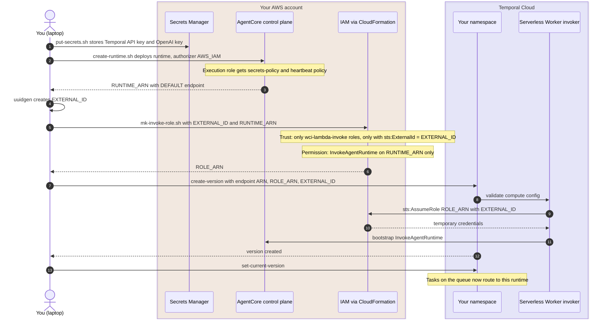
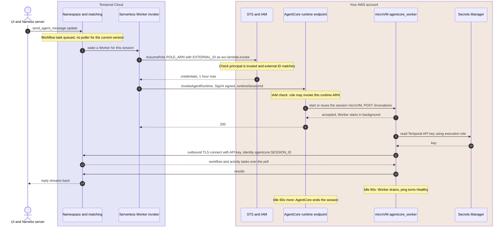

# How Temporal reaches the AgentCore runtime

The only connection from Temporal Cloud into our AWS account is the Serverless Worker invoker
(WCI) calling `InvokeAgentRuntime`. This doc shows what we set up once, and what happens on every
invoke. The step numbers in each table match the diagram above it.

These sequences come from this repo's README and scripts, not from Temporal's or AWS's source.
Two details are inferred:

- that `create-version` validates the setup by assuming the role and invoking the runtime,
  based on the README's auth-error note and the bootstrap session we observed;
- exactly when the Worker reads its secret.

## 1. Configuration (one time, README steps 1–5)

| Step | What it sets up | Why it matters for security |
|---|---|---|
| 1 | The Worker's own Temporal credential, kept in Secrets Manager rather than in config. | Only the runtime's execution role can read it. Temporal never sees it or uses it on the invoke path. |
| 2–3 | The runtime, with the `AWS_IAM` authorizer. | There's no public URL. The only way in is a SigV4-signed `InvokeAgentRuntime` call that IAM allows. |
| 4–6 | The invoke role: who can assume it, and what it can do. | The trust policy names only Temporal's invoker roles and requires our external ID, so another Temporal customer can't point their version at our role. The role's one permission is invoking this runtime. |
| 7–12 | The Worker Deployment Version, which records the endpoint, role and external ID. | Temporal checks that it can assume the role and reach the runtime, so a wrong trust policy fails here with an auth error. The bootstrap invoke is why the status page shows a session with no workflow. |
| 13 | Making the version current. | Until this step, nothing routes to the runtime. |

## 2. The invoke (every time work arrives)

A prompt from the UI becomes a workflow task with no Worker polling for it, and the invoker wakes
one up. The task itself never travels in the invoke. The Worker connects out to Temporal and
fetches it.

| Step | Check | What it stops |
|---|---|---|
| 3–4 | STS checks that the caller is one of Temporal's invoker roles and that the external ID matches. | Callers other than Temporal's invoker, and other Temporal customers who know our role ARN. |
| 5 | IAM checks that the role may call `InvokeAgentRuntime` on this runtime ARN. | Using the credentials on any other resource. They can't read data or change anything. |
| 6–8 | The invoke itself, which says only "start a Worker for this session" and carries no task data. | Injecting work. A forged invoke can at most start a Worker that polls our own queue. |
| 9–13 | The Worker authenticating to Temporal with its own key, on an outbound connection. | Reading or doing work without the namespace credential, which Temporal's invoker never holds. |

**Two separate trust paths meet in the microVM:**

- **Inbound:** Temporal can only wake the runtime, through a role we scoped.
- **Outbound:** the Worker authenticates to Temporal with our own key.

The worst a misused invoke can do is cost money, by starting microVMs that then idle out.
